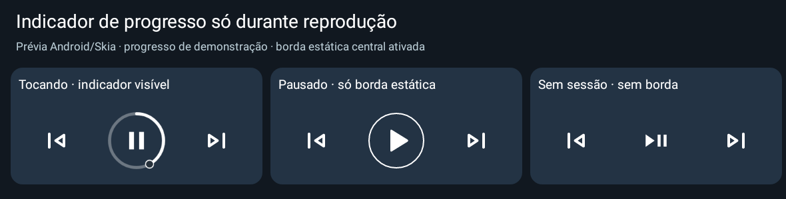
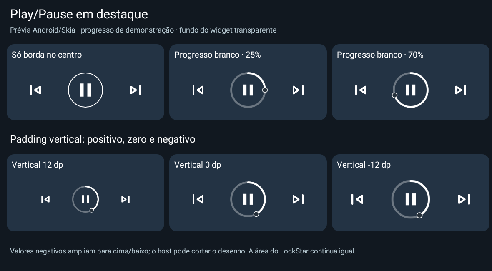
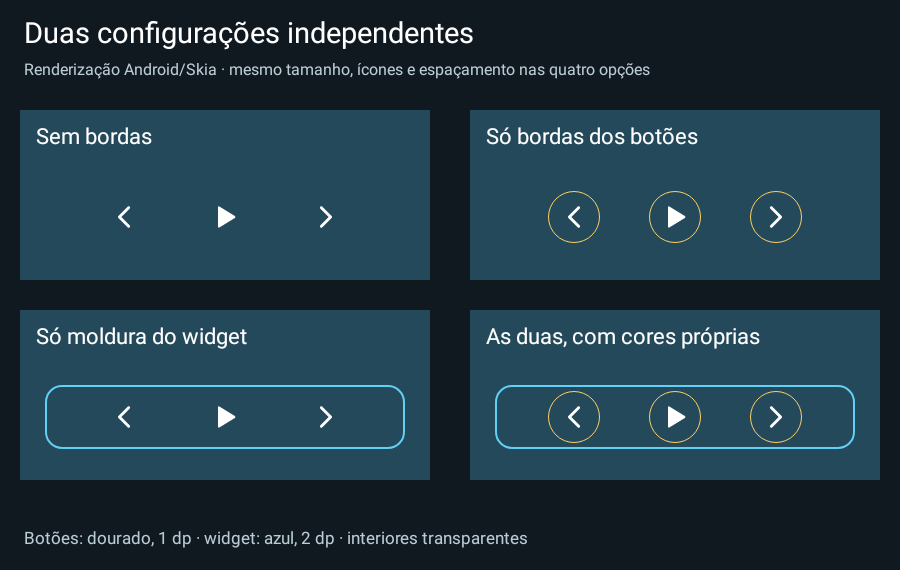
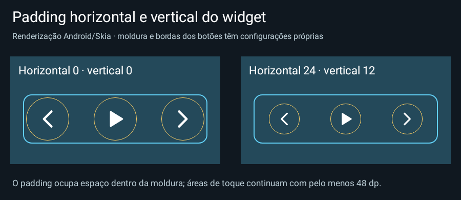
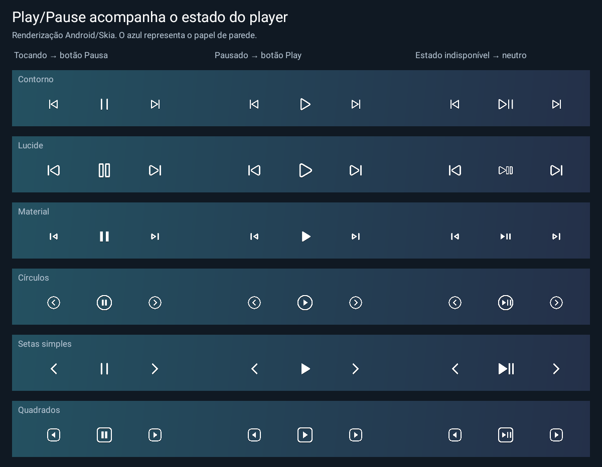
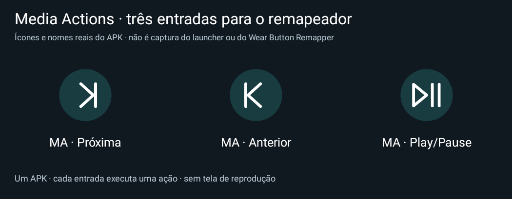

# Media Actions for Routines — 0.15 experimental

Atalhos de **Anterior, Play/Pause e Próxima** para Rotinas Samsung, widget transparente e redimensionável para hosts Android como LockStar, e companion Wear OS com três entradas para **Wear Button Remapper**.

**APKs:** [Celular 0.15](downloads/v0.15-experimental/media-actions-phone-0.15-experimental-debug.apk) · [Relógio 0.8](downloads/v0.8-experimental/media-actions-wear-0.8-experimental-debug.apk) · [Checksums e instruções 0.15](downloads/v0.15-experimental/README.md).

Esta versão é experimental. Testes em Android simulado não confirmam integração física com S25/LockStar/Watch 8. As funções de mídia usam sessões elegíveis e ações anunciadas pelo player; Spotify Connect remoto pode não expor uma sessão local controlável.

## Celular

Requer Android 13/API 33 ou superior. Instale o APK **phone** como atualização, abra Media Actions e conceda **Notification access** nas configurações Android. Essa autorização também pode expor notificações ao serviço; nosso app só utiliza os controladores das sessões e não lê/armazena conteúdo de notificações. Instalação por sideload pode exigir a opção Android de permitir configurações restritas para o app.

Inicie um player no celular e use os botões de teste. Em Modos e Rotinas, procure “Abrir um aplicativo ou executar uma ação do aplicativo → Media Actions” e selecione um dos três atalhos. Routines+ pode oferecer gestos físicos conforme o firmware. Teste desbloqueado e depois com bloqueio seguro/tela apagada; o app não altera políticas de bloqueio, desbloqueia o aparelho ou intercepta teclas físicas.

As chamadas por atalho executam a ação e encerram sem tela de player. O Android/Routines+ ainda pode alterar foco ou mostrar transições; a compatibilidade exata depende do sistema. O problema de restauração de gestos em rotinas por evento não foi resolvido por remapeamento próprio: veja [ROUTINES_BUTTON_RESTORE.md](docs/ROUTINES_BUTTON_RESTORE.md).

Correção 0.15: Play/Pause sem sessão conecta ao serviço de mídia do **Spotify**, solicita retomada e aguarda confirmação de PLAYING por até seis segundos. O broadcast da 0.11–0.14 não funcionou no aparelho do usuário e foi removido. A linha **Last Spotify resume** no app mostra o último resultado concluído, com motivo de falha. Não abre interface nem interfere na prioridade de uma sessão existente. [Fluxo, fontes e teste no aparelho](docs/SPOTIFY_FALLBACK.md). Testes simulam a conexão; Spotify ainda pode rejeitar o cliente ou não ter fila reproduzível. O protocolo Wear permanece igual.

URIs existentes preservadas:

- `mediaactions://run/next`
- `mediaactions://run/previous`
- `mediaactions://run/toggle`

## Widget e LockStar

Novidade 0.14: progresso circular **somente em reprodução confirmada**. Pausa mantém a borda estática escolhida; sem sessão/estado disponível, os botões ficam sem borda decorativa.



Correção 0.13 após review: o progresso periódico só é agendado quando há posição/duração calculáveis, e suas atualizações alcançam apenas widgets com indicador ativado. Mudanças reais de Play/Pause continuam atualizando todos. O intervalo permanece em 5 s. [Achados, reprodução e correções](docs/reviews/post-release-0.12-audit.md).

Novidade 0.12: **borda só no Play/Pause**, opção de **progresso circular branco com marcador escuro** e **padding negativo somente vertical**, de −24 a 144 dp. [Configuração e limites](docs/CIRCULAR_PROGRESS.md).



Novidade 0.10: **bordas dos botões e moldura do widget independentes**, cada grupo com ativação, espessura de 1–8 dp e cor/opacidade próprias. É possível usar as duas, uma ou nenhuma, mantendo os centros transparentes. **Padding horizontal e vertical somente do widget inteiro**, com campo numérico, slider e passos de 1 dp. [Configuração, limites e renderização](docs/INDEPENDENT_BORDERS.md). O companion Wear permanece na versão 0.8 e não precisa ser atualizado para estas funções.





O widget Media controls tem fundo transparente e três áreas de toque de pelo menos 48 dp. A aparência permite famílias de ícones distintas, tamanho, cor, sombra opcional, espaçamento com ajuste numérico preciso e feedback de toque. As configurações são por instância; valores legados continuam compatíveis.

Play/Pause acompanha o estado informado pelo player: Pausa durante reprodução, Play em pausa/parada e símbolo neutro quando o estado é desconhecido/transitório. Mudanças externas atualizam por callbacks, sem persistência do estado de reprodução. Com progresso circular ativado, a posição também é atualizada aproximadamente a cada 5 segundos enquanto toca e a tela está interativa. Um clique não é tratado como confirmação de mudança.

Para editar, use a configuração externa oferecida pelo host, quando disponível. O app declara suporte Android a reconfiguração e tem uma tela dedicada à instância escolhida. O menu do LockStar é controlado pela Samsung; declarar suporte não garante a presença de “Editar” em todo firmware. O botão **Edit existing widget** no app oferece acesso alternativo à configuração. Não há botão extra de edição dentro do widget. Veja [a pesquisa LockStar](docs/LOCKSTAR_WIDGET_EDITING.md).



As imagens usam papel de parede de exemplo e renderização nativa Android, sem capturar um host Samsung real. O efeito de toque é um realce/fade XML; a animação completa do host físico continua pendente de teste.

## Wear OS e Wear Button Remapper

Instale o APK **wear** no relógio e a versão **phone** no celular. Um único APK Wear oferece três itens selecionáveis por componente no WBR:

- **MA · Anterior**
- **MA · Play/Pause**
- **MA · Próxima**

Cada item tem seu ícone e executa uma ação fixa, sem tela de reprodução. Não são três pacotes e não dependem de shortcuts internos no launcher. O WBR identifica os gestos e abre o componente; nosso app não captura os botões globalmente nem solicita acessibilidade.



Essa imagem é uma comparação dos recursos do APK; não é captura da home Samsung ou do WBR. A inspeção do WBR 1.06 confirmou enumeração de Activities launcher e lançamento por componente. A seleção/execução física no Watch 8 permanece pendente.

A seleção de aparelho é automática: apenas um tocando → ele; ambos tocando → celular; ambos pausados → último controlado, com celular inicialmente. Não há troca de destino nem repetição automática após enviar um comando. Controle de players do relógio exige autorização **no relógio**, ainda não demonstrada neste firmware. Sem ela, é possível usar o caminho celular quando conectado e com acesso concedido no telefone. Consulte [instalação, bindings e acesso local](docs/WEAR_BUTTON_REMAPPER.md).

## Privacidade e transporte

Os atalhos/widget do celular executam localmente. O companion usa Google Play services Data Layer, que pode transportar por Bluetooth ou infraestrutura de nuvem; não se promete Bluetooth exclusivo. Não há servidor próprio, login Spotify, envio de áudio, título/artista, conteúdo de notificações ou telemetria de mídia.

Os APKs não contêm `uses-permission`; a autorização de listener é uma concessão separada do sistema. O novo serviço Data Layer é exportado conforme o contrato Google, com validação de callers pelo Binder do SDK e pareamento por applicationId/certificado. Não há receiver de comando remoto aberto por broadcast simples.

## Build e validação

JDK 21 para executar Gradle; bytecode Java/Kotlin 17. AGP 8.13.2, Kotlin 2.2.21, Gradle 8.14.6, compile/target SDK 36, minSdk 33 e Google Play services Wearable 20.0.1. Módulos `:app` (celular), `:wear` (relógio) e `:shared` (contratos/seleção/gateway/protocolo).

```sh
./gradlew :app:assembleDebug :wear:assembleDebug testDebugUnitTest lintDebug
```

Os APKs debug fornecidos usam o mesmo certificado dos APKs anteriores para preservar atualização. Não há chave privada no repositório; para distribuição futura, manter sua chave fora do projeto e preservar a identidade das instalações. Celular e relógio precisam compartilhar applicationId/certificado para Data Layer.

Resultados da versão: [self-audit 0.15](docs/reviews/spotify-browser-0.15.md), [self-audit 0.14](docs/reviews/playing-only-0.14.md), [review pós-publicação](docs/reviews/post-release-0.12-audit.md), [self-audit 0.12](docs/reviews/progress-ring-0.12.md), [self-audit 0.11](docs/reviews/spotify-fallback-0.11.md), [self-audit do widget 0.10](docs/reviews/independent-borders-0.10.md), [revisão Wear](docs/reviews/wear-button-remapper-implementation.md), [plano Wear](docs/planos/wear-os-galaxy-watch-8.md), [relatório de testes](TEST_REPORT.md), [créditos de ícones](THIRD_PARTY_NOTICES.md). Nenhum teste de host substitui as verificações físicas pendentes.
