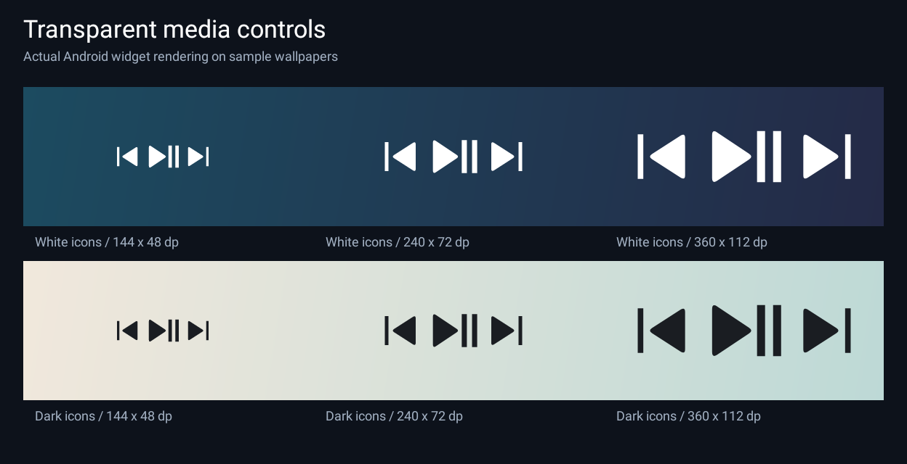

# Media Actions for Routines — experimental 0.3

**Build:** experimental 0.3. See the supplied APK and source artifacts.

App Android offline com atalhos de Próxima faixa, Faixa anterior e Play/Pause para
Rotinas Samsung, além de um widget redimensionável de três botões para hosts como
o LockStar. O widget agora é transparente e permite ajustar tamanho, cor e espaçamento
dos ícones em **Widget appearance**. Instale o APK, abra Media Actions e conceda Acesso a notificações.
No LockStar, procure **Media Actions → Media controls** no seletor de widgets,
se disponível. Consulte TEST_REPORT.md para os testes locais e lint; a integração real com
Samsung/LockStar e o uso com o telefone bloqueado ainda precisam de validação no S25.

A small, offline Android app exposing **Next track**, **Previous track**, and
**Play / Pause** as static app shortcuts. Samsung Modes and Routines may offer
these under **Open an app or do an app action**. Samsung compatibility and locked
physical-button operation **have not been verified**. Version 0.3 includes a transparent,
simple resizable **Media controls** widget for standard Android widget hosts,
including LockStar if supported by your firmware. LockStar placement and locked
widget interaction **have not been verified**. See [TEST_REPORT.md](TEST_REPORT.md).

## Install and set up

Requires Android 13 (API 33) or later. The intended device is Galaxy S25 SM-S931B.
No Spotify login is required. The supplied debug APK is for private testing.

1. Transfer `media-actions-0.3-experimental-debug.apk` to the phone and open it.
   Android may ask to allow installs from the app used to open the APK. Alternatively,
   use `adb install -r media-actions-0.3-experimental-debug.apk` on an authorized computer.
2. Open **Media Actions**, tap **Open Notification access**, and enable the app
   in Android's settings. This is a powerful system authorization; it cannot be
   granted by the app. The app uses it only for media-session controllers.
3. If Android marks a sideloaded app's Notification access as a restricted setting,
   review the app/source and Android's **App info → menu → Allow restricted settings**
   option if offered. Grant the normal notification-listener authorization yourself.
   No phone lock, screen-lock policy, or authentication setting needs to change.
4. Start Spotify playing **locally on the phone**. Return to Media Actions and tap
   **Refresh player**, then **Test Next**. Confirm exactly one track change.
   Remote Spotify Connect playback may expose no eligible local session.
5. Long-press the launcher icon and test **Next track** there first. If your launcher
   supports it, drag the shortcut onto the home screen for comparison.

Installation and enabling access need interaction. Later shortcut invocations do not
open the setup screen, settings, a toast, or a player app.

The supplied 0.3 APK uses the same package and debug certificate as the supplied 0.1
and 0.2 APKs, with a higher version code, so it can be installed as an update.

## Resizable widget for LockStar

The widget shows **Previous**, **Play / Pause**, and **Next** icons on a fully
transparent background. It requests a 3 × 1 starting size, resizes in both directions,
and can shrink to 144 × 48 dp while keeping 48 dp touch targets. The group stays
compact on wide widgets; increasing its available height allows larger icons.
The host controls available sizes, grid, placement, and resize handles.



Open **Media Actions → Widget appearance** to choose white/dark icons, adjust icon
size (75–135%) and spacing (0–24 dp), and press **Apply to widgets**. This applies to
all placed widgets. The preview wallpaper is not part of the widget. If LockStar
retains the old design after installation, apply the style in the app, then remove
and re-add the widget if the host still caches it. See [DESIGN_NOTES.md](DESIGN_NOTES.md)
for design references and rendering details.

1. Install the updated APK, open Media Actions, and grant Notification access.
2. Install or update **Good Lock → LockStar** through Samsung's supported store if
   needed. Routines+ is separate and is not needed for the widget.
3. Enable LockStar and edit the lock screen. Open the **widget area / Add widget**
   control if offered, then choose **Media Actions → Media controls**. Menu wording
   and support for ordinary app widgets depend on your LockStar / One UI version.
4. Place the row, drag its resize handles (or use LockStar's sizing controls), and
   save. Start local Spotify playback and test the three buttons with the lock screen
   visible. Record whether the host requests authentication before delivering taps.
5. If the widget is absent from LockStar, first try **Home screen → Widgets → Media
   Actions → Media controls**. A home-screen success does not prove LockStar support;
   record the exact LockStar version and available widget menu.

The widget uses direct immutable broadcast PendingIntents to a private receiver;
it does **not** launch the shortcut Activity or setup screen. This avoids an app
Activity launch from the widget, but LockStar/Android still determine locked
interaction policy. There is no unlock automation or bypass. Physical-button
routines keep their separate shortcut-based path.

These are static controls: the combined Play / Pause icon intentionally stays the
same, and no song title, artwork, notification content, or live player status is
shown. A tap selects the current media session at that moment. Missing access,
unsupported actions, or no eligible player cause no command and no pop-up; use the
app's test controls and `MediaActions` logs to diagnose them. The widget does not
poll or periodically refresh (`updatePeriodMillis=0`). Resizing or host updates do
not send playback commands. Removed widgets' control tokens are cancelled.

Appearance preferences store only icon size, spacing, and color locally. If a host
reports no dimensions, the fallback keeps flexible equal-width controls and applies
icon tuning with collapsed gaps. Exact grouping/scaling requires host size reports.
Any frame added by LockStar itself is separate from this fully transparent layout.

## Samsung routine and physical button

1. Open **Settings → Modes and Routines → Routines → +**.
2. Choose an **If** trigger. For physical buttons, inspect **Routines+ → Button action**
   if Samsung Good Lock / Routines+ is available on your firmware. Select only a button
   event Samsung actually offers. This app does not intercept keys.
3. Choose **Then → Apps → Open an app or do an app action → Media Actions → Next track**.
   Previous track and Play / Pause should be separate choices if Samsung discovers
   static shortcuts on that firmware. Wording may differ.
4. Save and test unlocked. Then securely lock the phone, turn the display off, and
   trigger it while local music plays. Record track movement, any unlock prompt,
   display wake, and duplicates separately. Do not weaken screen security to pass.

If the action is not listed, or Samsung requests unlock before launching it, this is
an unresolved invocation limitation. A successful launcher test does not establish
routine compatibility. Do not mark the MVP complete until the required S25 tests pass.

Samsung also documents **Settings → Advanced features → Side button → Double press →
Apps**, with a gear for supported in-app functions. Inspect this supported route as a
separate feasibility experiment if Routines cannot launch the shortcut. Availability
of these three shortcuts, secure-lock behavior, and display wake on that route are
also untested; it does not prove the Routines acceptance criterion. No hidden Samsung
APIs or security workarounds are implemented.

## Behavior and limitations

* **User-reported issue, unresolved:** triggering the Samsung routine appears to
  close the foreground app. It is not yet known whether that app is moved to the
  background or actually restarts/loses state. The shortcut launches a no-display
  Activity that calls `finish()` only on itself; an Activity/task focus change is a
  hypothesis, not a confirmed diagnosis. No corrective change for this report is
  included in 0.3. The widget's direct-broadcast path does not launch that Activity.
* Automatic targeting uses an eligible active session matching the system media-key
  session token, then a unique match for the system media-key package. Stale hints
  cannot introduce controllers. Otherwise the first playing session in Android's
  priority ordering wins. With no playing session, only one eligible session is safe
  to choose; multiple idle/transitional sessions return an ambiguity message.
* Null, none, and error playback states are ineligible. Paused and stopped sessions
  are eligible if they remain active in Android. Buffering, connecting, and skipping
  states may receive advertised Next/Previous; Play / Pause refuses to guess in those
  states. Fast-forwarding/rewinding count as playing for a pause request.
* Next/Previous require the corresponding advertised action. Playing toggles to Pause
  only with `ACTION_PAUSE`; paused/stopped toggles to Play only with `ACTION_PLAY`.
  A player advertising only `ACTION_PLAY_PAUSE` is deliberately unsupported in this
  version. No untested key-event fallback, retry, or global media broadcast is used.
* One invocation sends at most one transport command. Activity recreation is ignored.
  Separate invocations are not debounced: several Samsung trigger deliveries may
  cause several commands. Device tests must establish one delivery per button event.
* “Command sent” reports dispatch, not a verified track change. A player can ignore a
  command. Previous may restart the current song according to the player's behavior.
* The action Activity uses `Theme.NoDisplay`, finishes in `onCreate`, has empty task
  affinity, is excluded from recents, and has no history. It still counts as an
  Activity launch. There are no `showWhenLocked`, `turnScreenOn`, keyguard-dismissal,
  overlay, wake-lock, or direct-boot workarounds. Lock and wake behavior need S25 tests.
* Android manages the notification listener's binding. There is no app polling, timer,
  foreground service, persistent notification, scheduled job, or boot receiver. Idle
  battery impact and startup latency have not been measured on a phone.
* Ordinary process eviction and force-stop differ. Android can recreate the shortcut
  Activity after eviction. Force-stop intentionally restricts app components until an
  explicit relaunch; test separately. Pre-first-unlock operation is not promised.
* Player selection is automatic only. Spotify pinning is deferred beyond this proof of
  concept, as allowed by the handoff's P2 priority.

## Build and verify

Install a full JDK 17 or 21, Android SDK Platform 36, Build Tools 36.0.0, and platform
tools. Set `ANDROID_HOME` to the SDK, or set `sdk.dir` in an untracked `local.properties`.
The pinned toolchain is Gradle 8.14.6, Android Gradle Plugin 8.13.2, Kotlin 2.2.21.
The wrapper includes a distribution SHA-256 check. A build needs Maven/Google access
on first use; the installed app works offline.

```sh
./gradlew assembleDebug testDebugUnitTest lintDebug
adb install -r app/build/outputs/apk/debug/app-debug.apk
adb logcat -s MediaActions
```

The host suite tests selection, permission denial/revocation, one-command dispatch,
unsupported actions, and strict shortcut parsing. Robolectric exercises Android
entry points, widget layouts, control tokens, and packaged declarations at API 33
and 36. Robolectric is test-only
and is **not** an emulator, Samsung firmware, or real-device validation.

The debug build uses a locally generated Android debug signing key. Another machine's
debug build may have a different certificate and require uninstalling the old APK
(which revokes notification access). Source/tool versions are reproducible; byte-for-byte
APK reproducibility across machines/signing keys is not promised. Keep a private
release key outside this project if maintaining installed upgrades later.

## Device evidence and troubleshooting

Run `tools/device-info.sh > device-info.txt` with one authorized phone connected to
capture non-sensitive model/build/module versions. Fill the pending rows in
[TEST_REPORT.md](TEST_REPORT.md). For the action entry point alone (this **does not**
test Samsung's trigger or lock policy):

```sh
adb shell am start -n dev.local.mediaactions/.ActionActivity \
  -a android.intent.action.VIEW -d mediaactions://run/next
adb shell am start -n dev.local.mediaactions/.ActionActivity \
  -a android.intent.action.VIEW -d mediaactions://run/previous
adb shell am start -n dev.local.mediaactions/.ActionActivity \
  -a android.intent.action.VIEW -d mediaactions://run/toggle
```

* **Missing access:** open Notification access settings and check the app's grant;
  after returning, refresh. Revocation produces an error rather than opening settings
  from a shortcut.
* **No player:** start local playback. Inactive, error, and missing sessions are ignored.
* **Multiple idle players:** resume the intended player first.
* **Unsupported:** the selected player's advertised state/action does not permit the
  request. The app does not try another player or send duplicate fallback commands.
* **Sent but unchanged:** check that Spotify is playing on the phone and compare the
  launcher and Samsung routine separately. An accepted binder call is not feedback
  from the player.
* **Unlock prompt / missing button trigger:** record the exact firmware and routine
  configuration. This may block the requested feature even if media control works.

Logs contain only action/result codes and ignored-invocation notices, with tag
`MediaActions`. They never include intent text, media metadata, or notification
content. `adb shell dumpsys media_session` can help an experienced tester diagnose
sessions locally, but it may contain private media data; do not share its raw output.

## Security and privacy

The production manifest requests **no ordinary Android permissions**: no Internet,
media-content-control, notification-posting, storage, accessibility, or wake-lock
permission. The notification listener declares
`android.permission.BIND_NOTIFICATION_LISTENER_SERVICE` as its **binding permission**,
not a permission the app requests. Notification access is an explicit system grant.
The listener requests no notification categories by default and implements no content
callbacks. No content is read, stored, logged, uploaded, or transmitted by app code.

Exported components: the launcher/settings Activity and the explicit shortcut
`ActionActivity`. The latter has no browsable filter and accepts only `ACTION_VIEW`
with one of three exact URIs. No caller-supplied package or other extras affect
dispatch. Because shortcuts need an external launcher, any app able to explicitly
launch this exported Activity may request one of these bounded media commands once
the user has granted notification access. This is an intentional, documented surface.
The notification service is not exported and is protected by the system binding
permission. The widget provider is a **non-exported** receiver. Its three control
PendingIntents are explicit, immutable, and distinct for each button/widget instance.
Only an allowlisted command for a currently bound instance of this provider is
accepted. No periodic update is scheduled. There are no exported receivers or
providers, analytics, or backend.

## References

Official references consulted during implementation (2026-10-25):

* [Create app shortcuts](https://developer.android.com/develop/ui/compose/system/shortcuts/creating-shortcuts)
* [Manage shortcuts and trampoline task affinity](https://developer.android.com/develop/ui/compose/system/shortcuts/managing-shortcuts)
* [MediaSessionManager](https://developer.android.com/reference/android/media/session/MediaSessionManager)
* [NotificationListenerService](https://developer.android.com/reference/android/service/notification/NotificationListenerService)
* [MediaController.TransportControls](https://developer.android.com/reference/android/media/session/MediaController.TransportControls)
* [MediaController](https://developer.android.com/reference/android/media/session/MediaController)
* [PlaybackState](https://developer.android.com/reference/android/media/session/PlaybackState)
* [Samsung Modes and Routines](https://www.samsung.com/us/support/answer/ANS10002538/)
* [Samsung Side button](https://www.samsung.com/lb/support/mobile-devices/how-to-customise-the-side-button-with-new-features-on-your-galaxy-phone-and-tablet/)
* [Android app widgets](https://developer.android.com/develop/ui/views/appwidgets)
* [Flexible widget layouts and sizing](https://developer.android.com/develop/ui/views/appwidgets/layouts)
* [AppWidgetProviderInfo](https://developer.android.com/reference/android/appwidget/AppWidgetProviderInfo)
* [Widget interactions](https://developer.android.com/develop/ui/views/appwidgets/advanced)
