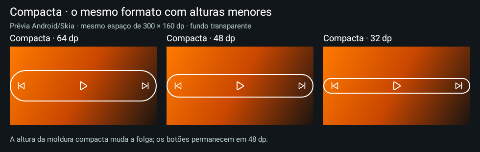

# Moldura compacta — 0.33

Em **Editar widget instalado → Bordas → Formato da moldura → Compacta**, ajuste **Altura da moldura** de **16 a 160 dp** e salve. O limite anterior de 56 dp foi removido. É o mesmo modo Compacta: a largura permanece igual, e a altura muda somente o contorno. O padrão 64 dp e as configurações instaladas não são alterados automaticamente.

Os botões conservam seus alvos de toque de 48 dp quando há espaço. Uma borda menor pode ficar dentro dessa área clicável; não é necessário reduzir os botões nem usar padding negativo. Ícones, espaçamento, cores manuais/automáticas, espessura e cantos continuam independentes. Volume vertical mantém a altura necessária para envolver os dois botões.

**Justa aos botões**, adicionada na 0.32, foi retirada do editor. Ajustes/rascunhos/backups com esse valor são lidos como Compacta, preservando os outros campos. O usuário escolhe a altura desejada no controle existente. **Preencher widget** permanece disponível.

A camada continua nativa, transparente, central e limitada ao espaço do host. Sem dimensões informadas, usa medição nativa. A largura e os mínimos da camada anterior são limpos na reaplicação. O launcher/LockStar continua decidindo a área reservada, os passos de redimensionamento e o timeout de tela.

Não acrescenta timer, serviço, permissão, bitmap de moldura ou consulta privilegiada. Backup continua v4, com importação v1/v2/v3/v4. Apps anteriores à 0.33 podem recusar backups com alturas menores que 56 dp; para voltar de versão, use uma cópia exportada antes da atualização.

Testes API 33/36 verificam 16/24/32/40/48/56dp, largura e alvo de 48 dp preservados, host com/sem dimensões, editor com os dois modos originais e salvamento de 32 dp, Store/Bundle/backup e leitura de configurações da opção removida. As imagens são Android/Skia; encaixe físico no LockStar e bateria não foram medidos pelo agente.

