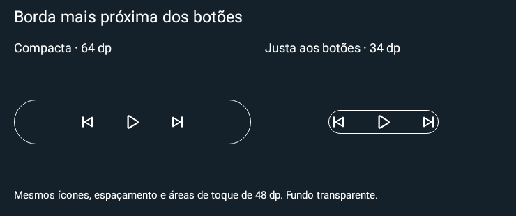

# Borda justa aos botões — 0.32

Em **Editar widget instalado → Bordas → Formato da moldura**, escolha **Justa aos botões** e salve. O contorno acompanha o tamanho visual dos ícones e a distância entre eles, na largura e na altura. As áreas de toque continuam com 48 dp quando há espaço; a moldura é decorativa e pode ficar dentro dessas áreas. O widget continua transparente. A altura manual fica oculta nesse modo, pois é calculada pelos controles.

Exemplo: ícones 60%, espaçamento 16 dp, borda 1 dp e sem borda individual/progresso resultam em moldura 34 dp de altura, em vez da altura 64 dp do modo Compacta. Reduzir os ícones aproxima mais o contorno; aumentar o espaçamento alarga o grupo. A folga visual soma a espessura da borda e 2 dp por lado. Não é necessário usar padding negativo.

Se o indicador estiver habilitado ou houver bordas individuais, reserva espaço para esses elementos, inclusive na pausa, evitando que o contorno mude de tamanho ao alternar play/pause. O indicador continua aparecendo apenas durante reprodução confirmada. Volume preserva a orientação horizontal/vertical. Distribuição automática continua espalhando os botões pelo espaço do host; desative-a se quiser também reduzir o espaço entre botões.

Cantos, espessura e cores manuais/automáticas continuam independentes. **Compacta** mantém altura manual e largura anterior; **Preencher widget** mantém a moldura externa. Configurações instaladas não são convertidas automaticamente para o novo modo.

O tamanho é calculado por aritmética com a geometria já usada nos ícones, sem ler pixels, gerar bitmap de moldura, consultar sessões ou adicionar timer, serviço ou permissão. Não muda a área reservada pelo launcher/LockStar, a política de tela ou os passos de redimensionamento. Quando o host não informa dimensões, os controles usam tamanho conservador e a moldura usa medição nativa limitada pelo pai.

Backup passa a exportar **v4**, com o novo valor de formato; importa v1/v2/v3/v4. Apps até 0.31 recusam v4. Ajustes de outras versões permanecem legíveis e não são alterados pela atualização.

Testes API 33/36: alvo 48 dp, formato/altura, escala/espaçamento, volume H/V, padding negativo, espessura grande, host pequeno/sem dimensões, reaplicação e limpeza de mínimos, editor/salvamento, Store/Bundle e backup. A imagem abaixo é renderizada por Android/Skia, não captura de Galaxy físico. Encaixe/gestos no LockStar precisam de validação no aparelho. Bateria não foi medida; a mudança não acrescenta trabalho recorrente.

