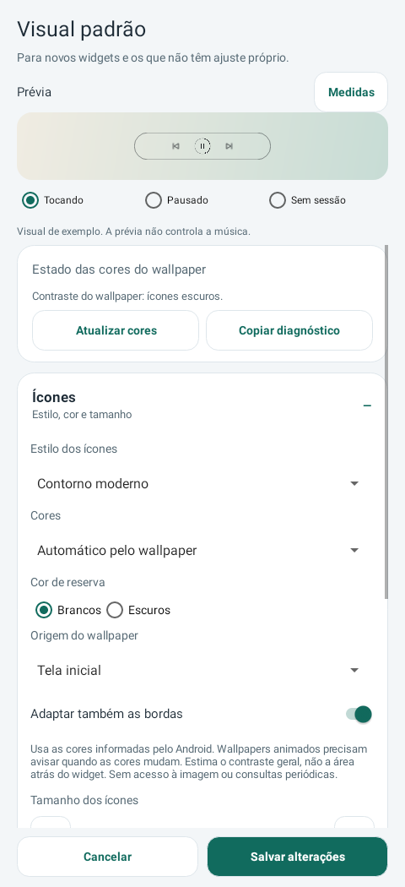

# Diagnóstico de cores — 0.34

O usuário informou automático e origem Bloqueio, com controles brancos sobre fundo branco, sem mensagem de status visível. A captura demonstra falta de contraste; não identifica se o Android devolve null, informa uma paleta não representativa, falha na consulta ou se há diferença entre edição e configuração aplicada. Esta versão prepara a verificação no aparelho; **não confirma que a adaptação com Depth esteja corrigida**.

No editor do widget, com Automático ativo, **Estado das cores do wallpaper** aparece em um cartão próprio antes dos grupos recolhíveis. Mostra consulta em andamento, cores disponíveis com decisão branco/escuro, ausência de dados com uso de reserva ou falha de API. O bloco anterior ficava dentro do grupo Ícones, abaixo das opções de origem/bordas. A ausência relatada não foi reproduzida nos testes locais; a nova posição torna o estado encontrável sem abrir os grupos.

**Atualizar cores** faz uma consulta explícita fora da UI, somente para a origem exibida. Não muda nem salva o rascunho. Cliques enquanto essa origem tem consulta pendente não iniciam outra. Uma consulta da tela inicial não bloqueia a releitura do bloqueio. Não há timer de retry; a retomada por eventos permanece como antes.

**Copiar diagnóstico** só escreve no clipboard após toque do usuário. Inclui versão/pacote do app, escopo da instância ou padrão global, modo/origem salvos e em edição, destino resolvido, estado da leitura, solicitação do listener, cor primária/hints informados pelo Android, classe de eventual erro, reserva e opção de bordas. Não contém imagem, conteúdo de notificações, sessão, títulos, stack trace ou mensagem da exceção. A leitura da paleta usa o cache; copiar não consulta de novo o wallpaper nem enumera sessões. A versão do próprio app é consultada no PackageManager. O clipboard é o do sistema: o usuário decide onde colar.

Para investigar o caso: abrir **o widget instalado correspondente**, confirmar Automático/Bloqueio e salvar se houver alteração; voltar ao editor, tocar Atualizar cores, aguardar o estado final, tocar Copiar diagnóstico e enviar o texto. Se o texto indicar indisponibilidade ou falha, a reserva continua sendo usada. Se indicar primária escura e ícones brancos apesar do fundo branco, a informação recebida não descreve o fundo como esperado. Se indicar ícones escuros mas o widget continuar branco, investigar entrega/configuração da instância/host. Nenhum desses resultados foi coletado no aparelho do usuário ainda.

A decisão de contraste a partir do wallpaper não foi alterada nesta entrega. Foi corrigido um erro de aplicação: quando não há detecção, Adaptar também as bordas agora usa a cor de reserva nos dois tipos de borda, preservando o alfa. O modo manual mantém as cores escolhidas. Continua usando hints/cor primária globais do [WallpaperManager](https://developer.android.com/reference/android/app/WallpaperManager#getWallpaperColors(int)); não lê a região atrás do widget. Live wallpapers podem omitir as cores ou suas mudanças. Não acrescenta privilégio, captura de tela, serviço, wake lock, alarme ou polling.

O cache contém até dois registros pequenos de contraste/paleta/erro; não exporta esses dados no backup. A entrega ao widget continua deduplicada pelo visual, independentemente de metadados. Com o editor aberto, uma mudança no estado/detalhe da leitura atualiza o diagnóstico mesmo se a decisão de contraste não mudar. Respostas tardias continuam protegidas por geração/revisão. Pausar o editor remove seu consumidor.

Testes API33/36 cobrem ausência de dados visível com grupos fechados, erro diferente de null, cópia sem mensagem privada, primária/hints reais da fixture, nenhuma consulta extra ao copiar, releitura e coalescência, consulta de bloqueio com tela inicial pendente, preservação de preferências, modo manual sem acesso ao wallpaper e diagnóstico protegido contra resposta antiga. Contadores são simulados, sem medição de bateria ou confirmação física de Depth/LockStar.

