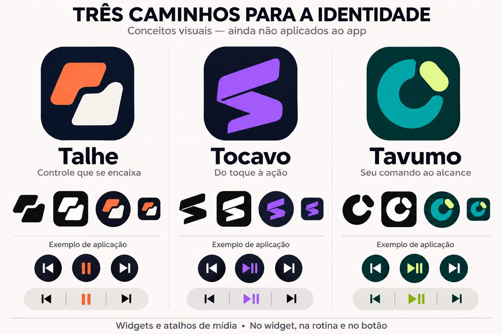

# Identidade — descoberta e triagem de nomes

**Data:** 14/11/2026. **Plano:** [Identidade do app](../planos/identidade-do-app.md). **Estado:** propostas para comparação visual; nenhum nome escolhido ou aplicado ao aplicativo. Pesquisa inicial de colisões, sem conclusão de registrabilidade.

## Proposta comum às alternativas

**Sua mídia, ao seu comando.** Descritor: **Widgets e atalhos de mídia**. A apresentação deve mostrar o mesmo propósito em três formas de acesso: widget, rotina e ação selecionável no relógio. O companion Wear é opcional e suas três ações continuam separadas e reconhecíveis.

Os nomes abaixo não pretendem descrever um player ou catálogo de músicas. A intenção é dar identidade a uma ferramenta de controle que se adapta à forma de usar o aparelho. A comparação com KWGT, widgets de música e Wear Media Toggle já está documentada no plano; funções isoladas não são reivindicadas como exclusivas.

## Três propostas para a prancha

| Nome | Pronúncia sugerida e ideia | Direção visual | Ponto que precisa ser avaliado |
| --- | --- | --- | --- |
| **Talhe** | **TA-lhe**, duas sílabas em PT-BR; forma, corte e ajuste à medida | **Encaixe:** duas massas complementares assimétricas com recorte central próprio; símbolo compacto, não uma letra T nem botão de Play | “lh” é menos natural em inglês. Há blog cultural homônimo e aproximação fonética com o app Talie; não ocultar esse risco |
| **Tocavo** | **to-CA-vo**; associação criativa entre toque e ritmo, sem etimologia histórica reivindicada | **Cadência:** traço contínuo dobrado com interrupção ritmada e silhueta angular; evitar equalizador ou onda sonora | O nome já aparece em exemplos de um gerador de nomes e como topônimo. A associação com “tocava” precisa ser testada oralmente |
| **Tavumo** | **ta-VU-mo**; associação criativa entre toque/comando e volume; nome abstrato de três sílabas | **Órbita:** massa circular interrompida e corte deslocado; leitura tátil, sem triângulo central ou anel fino de progresso | Há homônimo empresarial antigo em fonte pública. O significado depende do descritor e dos exemplos de uso |

São combinações sugeridas para tornar a comparação concreta. O usuário pode preferir o nome de uma proposta e o símbolo de outra. O território **Encaixe** continua sendo a recomendação de posicionamento; a escolha de nome precisa considerar também os riscos de Talhe. Tavumo é a reserva mais independente de uma palavra comum, mas não tem disponibilidade certificada.

As três imagens precisam diferir na construção: massas sólidas complementares, traço dobrado e massa circular interrompida. Cor e tipografia são apoio, não substitutos dessa diferença. A prancha usa coral sobre azul escuro para Talhe, violeta para Tocavo e verde-azulado com lima para Tavumo. São propostas, não cores aprovadas nem valores a aplicar aos widgets existentes.

## Rodada final de 12 candidatos

As notas são julgamento editorial de 0–5, não resultado de pesquisa com usuários. Pesos do plano: distinção/risco de confusão **30%**, relação com a proposta **25%**, pronúncia/memória **20%**, legibilidade **15%**, expansão **10%**. Risco relevante pode eliminar um nome independentemente da média.

| Candidato | Distinção | Proposta | Pronúncia | Legibilidade | Expansão | Média ponderada | Decisão e evidência |
| --- | ---: | ---: | ---: | ---: | ---: | ---: | --- |
| **Talhe** | 3 | 5 | 3 | 5 | 5 | **4,00** | Explorar na prancha, com ressalva fonética. Palavra natural; [Priberam](https://dicionario.priberam.org/talhe), [blog Talhe](https://talhe.blogspot.com/) e [Talie](https://talie.app/) |
| **Tocavo** | 4 | 4,5 | 4 | 4,5 | 4 | **4,20** | Explorar na prancha. Homônimo em [exemplos Nomik](https://nomik.com.br/gerador-de-nomes-para-instagram) e topônimo em [Fallingrain](https://www.fallingrain.com/world/MZ/06/Tocavo.html) |
| **Tavumo** | 4 | 4 | 4 | 4,5 | 4,5 | **4,13** | Explorar na prancha. [Diário público sul-africano de 2006](https://www.gov.za/sites/default/files/gcis_document/201409/28817b.pdf) menciona Tavumo Trading Enterprise; não é prova de marca atual ou de app |
| Cadumo | 3 | 4 | 4 | 4,5 | 4 | 3,78 | Reserva descartada da prancha: terminação próxima de Tavumo e homônimos; variedade de trigo em [Agroscope](https://ira.agroscope.ch/de-CH/Page/Einzelpublikation/Download?einzelpublikationId=65653) |
| Orvumo | 2 | 3,5 | 3,5 | 4,5 | 4,5 | 3,30 | Retirado após busca fonética: proximidade com **ORVUM**, software varejista, em [termos oficiais](https://www.orvum.com/terms) |
| Orvio | 1 | 3 | 4 | 5 | 4 | 3,00 | Descartado: nome já usado por produtos de software, incluindo [Orvio](https://getorvio.app/) e [Orvio AI](https://play.google.com/store/apps/details?id=com.aetherlab.promptstudio) |
| Nodivo | 1 | 4 | 4 | 5 | 4 | 3,25 | Descartado: [Nodivo — editor de diagramas](https://www.figbell.com/en/nodivo/info) e [ecossistema Nodivo](https://getnodivo.com/) |
| Ritavo | 1 | 4 | 4 | 5 | 4 | 3,25 | Descartado: app [Ritavo Retail](https://play.google.com/store/apps/details?id=com.ritavo.retail) e marca empresarial associada |
| Alcavo | 1,5 | 4 | 4 | 4,5 | 4,5 | 3,38 | Descartado: proximidade direta com serviços de software de [Alcavo Solutions](https://alcavo-solutions.com/en/) |
| Toclo | 2 | 4 | 3 | 4,5 | 4 | 3,28 | Descartado: encontro consonantal menos natural e nome já usado por pacote de software [toclo](https://pypi.org/project/toclo/) |
| Atilho | 1,5 | 4,5 | 3 | 4,5 | 5 | 3,35 | Descartado: app homônimo apresentado no perfil [Atilho](https://www.linkedin.com/showcase/atilho-app/); “lh” mantém dificuldade em inglês |
| Vinco | 1 | 4 | 4 | 5 | 4 | 3,25 | Descartado: múltiplos apps homônimos, incluindo [Vinco Team](https://play.google.com/store/apps/details?id=com.vincoteam.app) |

Os homônimos em áreas diferentes foram registrados como sinais para investigar, não tratados automaticamente como impedimento legal. Os nomes retirados por colisões de software não devem ser recuperados somente por uma preferência de cor ou logotipo.

## Consultas efetuadas e limites

Pesquisa por buscador web, com nomes entre aspas e combinações `app`, `software`, `music`, `widget` e equivalentes em português. Para os finalistas, foram usados também filtros de domínio e consultas de variantes. O resultado abaixo descreve apenas a amostra devolvida pelo buscador; não é uma consulta completa aos catálogos das lojas.

| Fonte/recorte | Consultas | Resultado e limite |
| --- | --- | --- |
| Web geral | Nomes exatos dos candidatos com contexto de aplicativos/mídia e, para os finalistas, sem contexto | Colisões relevantes registradas na tabela. Nenhum app de mídia homônimo exato dos três finalistas foi identificado na amostra; isso não demonstra inexistência |
| Google Play | `"Tavumo"`, `"Cadumo"`, `"Orvumo"` com domínio `play.google.com`; `"Talhe" app` e `"Tocavo"` com domínio de loja | Consultas não identificaram título homônimo exato dos finalistas. Talhe apareceu em texto de avaliações de outros apps, sem ser nome desses apps. Não confundir menção com colisão de título |
| GitHub | Nomes exatos com domínio `github.com`, incluindo Talhe/Tocavo/Tavumo/Orvumo | Sem projeto homônimo de mídia identificado; Talhe aparece em listas de palavras. Não comprova disponibilidade de organização ou usuário |
| Galaxy Store | Nomes exatos com domínio `galaxystore.samsung.com` e consultas com “Samsung Galaxy Store” | Nenhum resultado relevante identificado na amostra; a indexação pode ser incompleta e variar por região. Catálogo completo não verificado |
| Variações fonéticas/gráficas | Talhe/Talie, Tocavo/Tokavo, Orvumo/Orvomo, Cadumo/Kadumo | Talie já é app; ORVUM surgiu como aproximação relevante e motivou retirar Orvumo. Variações não equivalem a pesquisa fonética exaustiva |
| INPI | Portal público e acesso anônimo a `Pesquisa_classe_basica.jsp` | O endpoint retornou **HTTP 503 Service Unavailable** na tentativa direta e timeout no acesso web. **Busca por nomes/radicais na base de marcas não concluída** |

O [portal do INPI](https://www.gov.br/inpi/pt-br/assuntos/marcas) aponta para a base de pesquisa. A [orientação oficial](https://www.gov.br/inpi/pt-br/plataforma-integrada-de-atendimento/logica-dos-servicos) recomenda buscar também aproximações por radical e fonética. A indisponibilidade observada não exige credenciais do usuário nem autoriza contornar o portal. A pesquisa de marcas permanece pendente, especialmente para o nome que for preferido na prancha.

Não houve compra de domínio, reserva de perfil, protocolo de registro ou alteração de nome/pacote. Nenhum dos resultados acima garante registrabilidade, exclusividade global ou inexistência de conflito em outra região.

## Prancha apresentada para escolha

Prancha conceitual apresentada em 14/11/2026, criada com assistência de geração de imagem. Ainda não representa recursos nativos do APK; os exemplos de widgets e entradas Wear são ilustrativos.

A comparação usa **Talhe / Tocavo / Tavumo**, marcados como **conceitos**, com o mesmo descritor e aplicações comparáveis. Mostrar cada símbolo grande, monocromático, em máscaras de launcher e em tamanho pequeno. Nas entradas Wear, manter Anterior/Play-Pause/Próxima legíveis e distinguíveis, com a assinatura da marca em papel secundário.

A escolha deve avaliar o conjunto: qual proposta parece uma ferramenta de comando pessoal e reconhecível, sem depender de uma cor ou de um símbolo padrão de player. Não há feedback de usuários externos nesta etapa. A aprovação do usuário, a revisão da arte final, recursos nativos e validações de upgrade continuam sendo etapas próprias do plano.
