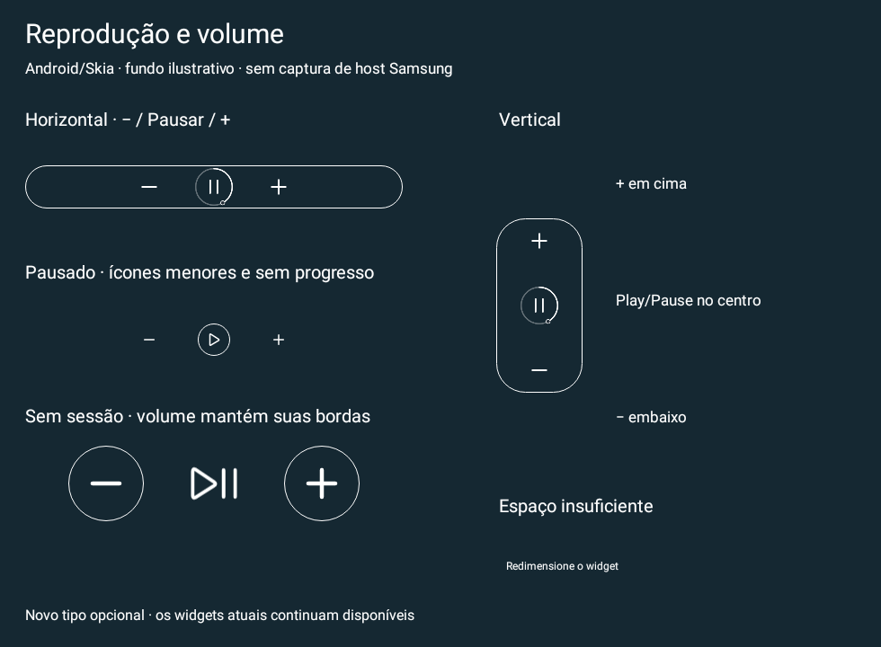
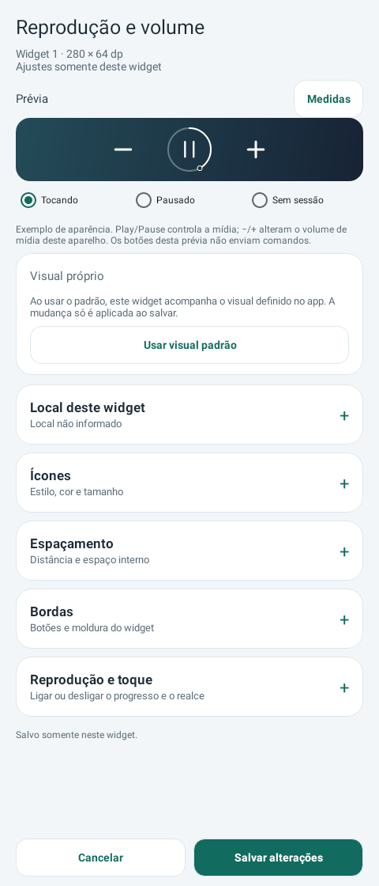

# Execução dos planos — candidato 0.35

**Data:** 14/11/2026. **Base:** `b610b9a5b7ee4755b6d7493d00e22902a8cb85c0`. **Estado:** implementação candidata; validação completa ainda em andamento, nenhum novo APK oficial publicado.

## Escopo executado

- Terceiro widget Reprodução e volume, horizontal/vertical, com configuração por instância e progressão opcional no centro. Os dois providers antigos e os contratos Wear permanecem.
- Identidade por `WidgetKind`, atualização única por lote, integração no observador/listener/wallpaper/editor e isolamento dos três comandos. Volume não provoca refresh nem consulta de mídia.
- Perfis com tipo explícito, exportação v5/importação v1–v5 e aplicação estrita ao tipo instalado. Não há migração automática de widgets ou chaves visuais.
- Identidade visual: pesquisa de 12 nomes, três propostas com silhuetas distintas e prancha apresentada. **Talhe / Tocavo / Tavumo** aguardam escolha do usuário. Nenhuma marca definitiva foi aplicada ao APK.

Uso e limites: [widget combinado](../PLAYBACK_VOLUME_WIDGET.md), [backup](../BACKUP.md), [triagem e propostas](../identidade/naming.md).

As imagens do widget usam Android/Skia em testes de host. Não são capturas de One UI/LockStar. A prancha de identidade é conceito gerado com assistência de imagem, não recursos finais do app.

## Revisões e correções

Self-audit do diff contra os dois planos, com leitura dos arquivos e callers afetados. Revisão independente adicional e plugins [Permission Manager](combined-permission-manager-0.35.md) e [CI eficiente](combined-ci-0.35.md) registrados separadamente. Não houve necessidade de integração privilegiada ou alteração da orquestração.

Três achados médios de produto foram corrigidos:

1. Falta de feedback ao clicar Play/Pause sem acesso: orientação por Toast após o gesto, sem abrir Activity e sem bloquear volume; conclusão protegida contra duplicação.
2. Padding negativo em FILL podia cortar alvos de toque: combinado limita o padding efetivo se o grupo ultrapassar o host; conserva valor salvo e comportamento dos widgets antigos. Testes verificam bounds globais, não só o tamanho de cada View.
3. Falha de um host interrompia atualização dos demais: lote e cache agora tentam todos os IDs, conservam o primeiro erro e o propagam ao final. Somente entregas bem-sucedidas recebem chave atualizada; nova tentativa depende de evento.

Falhas iniciais em fixtures foram corrigidas sem enfraquecer o contrato: construtor Android rejeita SizeF NaN antes de chamar o código; confirmação de AlertDialog precisa ser processada antes de aguardar worker; teardown do framework pode notificar desconexão e destruição e não garante uma contagem única de atualizações.

## Validação e pendências

Testes focados exercitam provider/URI/ID, comandos, recusa de autorização, volume sem grant e com sessão autorizada, snapshot compartilhado, deduplicação, progresso, tela apagada, destruição/reconexão, falha de host, edição, geometria, wallpaper e backup legado/v5 em APIs 33/36. Resultado final da cadeia completa e artefatos serão registrados após a execução, sem tratar os primeiros runs com falhas como passe.

O recorte CI passou nos 23 testes de orquestração e preserva a classificação FULL. Dois runs documentais remotos recentes tiveram sucesso; isso atualiza o histórico de bloqueio de faturamento, mas não comprova um completo Android remoto.

`adb devices -l` não encontrou dispositivo conectado nesta sessão. Comparação antes/depois no mesmo S25/Tab S10+, recuperação física, host LockStar e bindings Watch 8 não foram medidos aqui. Contadores de trabalho automatizados não são uma medição de bateria. Assinatura, hashes e publicação dependem do artefato exato validado e da chave histórica; não se publica identidade ainda não escolhida.
