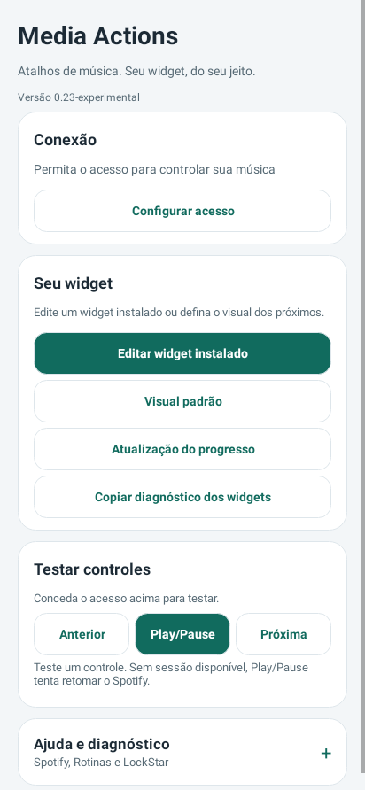

# Media Actions 0.23 experimental

Aplicativo original atualizado com as correções de salvamento, diagnóstico e conflitos do editor. Instale sobre o Media Actions original para manter seus dados e ficar com um app no celular; depois confira e remova somente a Preview, se instalada. Preferências exclusivas da Preview não são copiadas automaticamente. Wear permanece 0.9; validação física ainda pendente.

**[Baixar APK phone 0.23](https://github.com/brenopoubel0324/media-actions-for-samsung-routines/raw/refs/tags/v0.23-experimental/downloads/v0.23-experimental/media-actions-phone-0.23-experimental-debug.apk)** · [Baixar APK Wear 0.9](https://github.com/brenopoubel0324/media-actions-for-samsung-routines/raw/refs/tags/v0.23-experimental/downloads/v0.21-experimental/media-actions-wear-0.9-experimental-debug.apk)

Para ficar com um app no celular:

1. Instale o APK phone 0.23 sobre **Media Actions**, sem desinstalar o original.
2. Abra o original e confira suas configurações/widgets. Widgets criados pela Preview pertencem a ela; recrie-os no original se necessário.
3. Depois remova somente **Media Actions Preview** pelo Android.

As preferências do original são mantidas. Ajustes exclusivos da Preview não são importados automaticamente. O APK Wear é para o relógio e não precisa ser reinstalado nesta entrega.

Validação: **479 testes**, lint aprovado, build e self-audit. [Review](https://github.com/brenopoubel0324/media-actions-for-samsung-routines/blob/v0.23-experimental/docs/reviews/entrega-original-0.23.md) · [Arquivos/checksums](https://github.com/brenopoubel0324/media-actions-for-samsung-routines/tree/v0.23-experimental/downloads/v0.23-experimental).

Instale como atualização sem desinstalar. Mesmo applicationId/certificado, preferências anteriores preservadas e zero uses-permission. Protocolo Wear v1 compatível. As imagens são renderizações nativas Android/Skia, não capturas de Galaxy físico. Energia/bateria, Spotify/LockStar e WBR físico continuam pendentes de teste; menos consultas/ticks não comprovam economia de bateria.

SHA-256 phone: `655b1327e744c3a677450a00a36544778fee071e773f98775ceb6405427e6e82`.
