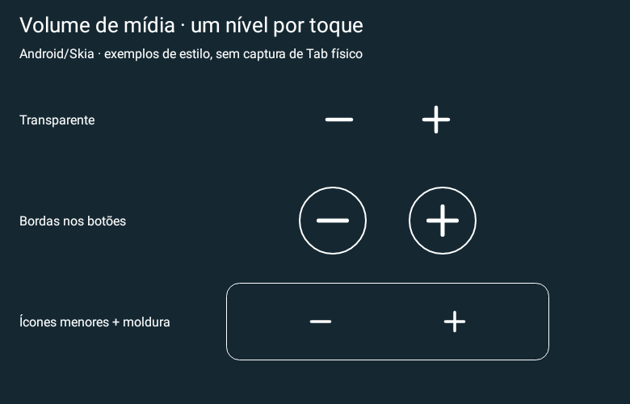
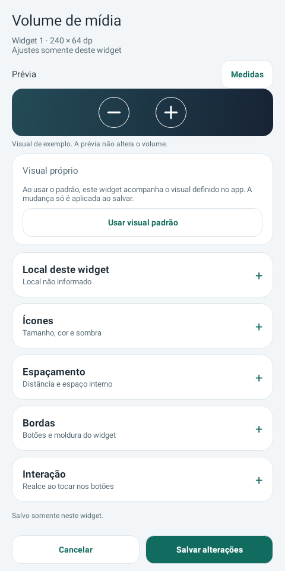

# Media Actions 0.24 experimental

Novo widget Volume de mídia com −/+ por clique no próprio tablet/celular, transparente e redimensionável, com tamanho, espaçamento e bordas editáveis por instância. Funciona sem acesso às notificações e sem polling de volume. Permissão normal de áudio local; mesmo app original, Wear 0.9 preservado. Teste físico no Tab S10+ ainda pendente.

**[Baixar APK phone 0.24](https://github.com/brenopoubel0324/media-actions-for-samsung-routines/raw/refs/tags/v0.24-experimental/downloads/v0.24-experimental/media-actions-phone-0.24-experimental-debug.apk)** · [Baixar APK Wear 0.9](https://github.com/brenopoubel0324/media-actions-for-samsung-routines/raw/refs/tags/v0.24-experimental/downloads/v0.21-experimental/media-actions-wear-0.9-experimental-debug.apk)

Instale o APK phone 0.24 como atualização do original. Para adicionar o novo widget: tela inicial → Widgets → Media Actions → **Volume de mídia**. Edite tamanho, espaçamento e bordas em **Editar widget instalado**. Não exige instalação de Preview nem acesso às notificações para os cliques de volume.

Validação: **497 testes**, lint aprovado, build e self-audit. [Review](https://github.com/brenopoubel0324/media-actions-for-samsung-routines/blob/v0.24-experimental/docs/reviews/volume-widget-0.24.md) · [Arquivos/checksums](https://github.com/brenopoubel0324/media-actions-for-samsung-routines/tree/v0.24-experimental/downloads/v0.24-experimental).

Instale como atualização sem desinstalar. Mesmo applicationId/certificado, preferências anteriores preservadas e uma permissão normal MODIFY_AUDIO_SETTINGS no phone. Protocolo Wear v1 compatível. As imagens são renderizações nativas Android/Skia, não capturas de Galaxy físico. Energia/bateria, Spotify/LockStar e WBR físico continuam pendentes de teste; menos consultas/ticks não comprovam economia de bateria.

SHA-256 phone: `75bf5b8a12161b54cea17f98937acc9af9a6be8d0b00d86381a554039f9cf715`.
