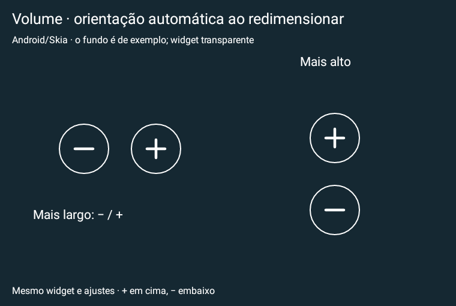

# Media Actions 0.25 experimental

O widget de volume adapta a orientação ao redimensionamento: horizontal com −/+ quando mais largo, vertical com + acima de − quando mais alto. Preserva a mesma instância e ajustes, com padding nos eixos físicos, sem sensor nem timer novo. Atualização do app original; Tab S10+ físico ainda não testado.

**[Baixar APK phone 0.25](https://github.com/brenopoubel0324/media-actions-for-samsung-routines/raw/refs/tags/v0.25-experimental/downloads/v0.25-experimental/media-actions-phone-0.25-experimental-debug.apk)** · [Baixar APK Wear 0.9](https://github.com/brenopoubel0324/media-actions-for-samsung-routines/raw/refs/tags/v0.25-experimental/downloads/v0.21-experimental/media-actions-wear-0.9-experimental-debug.apk)

Instale o APK phone 0.25 como atualização do original. Para adicionar o novo widget: tela inicial → Widgets → Media Actions → **Volume de mídia**. Edite tamanho, espaçamento e bordas em **Editar widget instalado**. Não exige instalação de Preview nem acesso às notificações para os cliques de volume.

Validação: **504 testes**, lint aprovado, build e self-audit. [Review](https://github.com/brenopoubel0324/media-actions-for-samsung-routines/blob/v0.25-experimental/docs/reviews/volume-orientacao-0.25.md) · [Arquivos/checksums](https://github.com/brenopoubel0324/media-actions-for-samsung-routines/tree/v0.25-experimental/downloads/v0.25-experimental).

Instale como atualização sem desinstalar. Mesmo applicationId/certificado, preferências anteriores preservadas e uma permissão normal MODIFY_AUDIO_SETTINGS no phone. Protocolo Wear v1 compatível. As imagens são renderizações nativas Android/Skia, não capturas de Galaxy físico. Energia/bateria, Spotify/LockStar e WBR físico continuam pendentes de teste; menos consultas/ticks não comprovam economia de bateria.

SHA-256 phone: `ba9f3dc42b95482b9f698d708845dd22f60b75d8501a20686d9dcfdbe96e0c09`.
