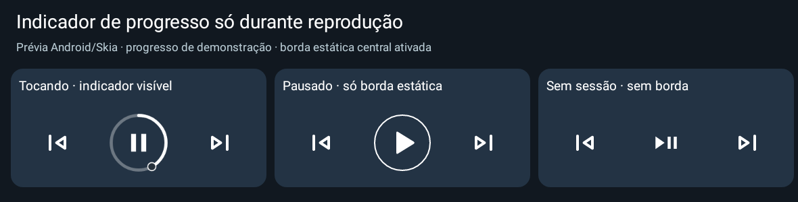

# Media Actions 0.26 experimental

Apresentação do widget orientada a eventos, cache efêmero e deduplicação visual; comandos mantêm verificações atuais. Em 60 s simulados com seis widgets/5 s: consultas de sessão 36→0 e metadados 24→0, mantendo 72 atualizações com avanço real. Dez callbacks idênticos em pausa: 60→0 atualizações. Sem polling de descoberta ou timer que acorde o aparelho; recuperação coberta em testes. Comparação física e economia de bateria NÃO MEDIDAS.

**[Baixar APK phone 0.26](https://github.com/brenopoubel0324/media-actions-for-samsung-routines/raw/refs/tags/v0.26-experimental/downloads/v0.26-experimental/media-actions-phone-0.26-experimental-debug.apk)** · [Baixar APK Wear 0.9](https://github.com/brenopoubel0324/media-actions-for-samsung-routines/raw/refs/tags/v0.26-experimental/downloads/v0.21-experimental/media-actions-wear-0.9-experimental-debug.apk)

Instale o APK phone 0.26 como atualização do app original, sem desinstalar. Nenhum segundo aplicativo é necessário. O companion Wear permanece 0.9.

[Comparação de trabalho e limites](https://github.com/brenopoubel0324/media-actions-for-samsung-routines/blob/v0.26-experimental/docs/medicoes/energia-0.26/README.md) · [Protocolo físico pendente](https://github.com/brenopoubel0324/media-actions-for-samsung-routines/blob/v0.26-experimental/docs/medicoes/energia-0.26/protocolo-dispositivo.md). **Bateria/CPU e recuperação no mesmo dispositivo físico NÃO MEDIDAS.**

Validação: **526 testes**, lint aprovado, build e self-audit. [Review](https://github.com/brenopoubel0324/media-actions-for-samsung-routines/blob/v0.26-experimental/docs/reviews/background-0.26.md) · [Arquivos/checksums](https://github.com/brenopoubel0324/media-actions-for-samsung-routines/tree/v0.26-experimental/downloads/v0.26-experimental).

Instale como atualização sem desinstalar. Mesmo applicationId/certificado, preferências anteriores preservadas e uma permissão normal MODIFY_AUDIO_SETTINGS no phone. Protocolo Wear v1 compatível. As imagens são renderizações nativas Android/Skia, não capturas de Galaxy físico. Energia/bateria, Spotify/LockStar e WBR físico continuam pendentes de teste; menos consultas/ticks não comprovam economia de bateria.

SHA-256 phone: `2c1c03fb6fda3577bc15fc197f6a70df1d03b5aa062f4dae05a67b8fb46df614`.
