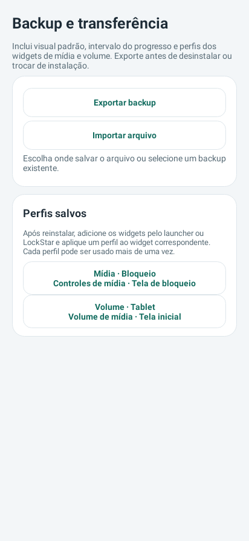
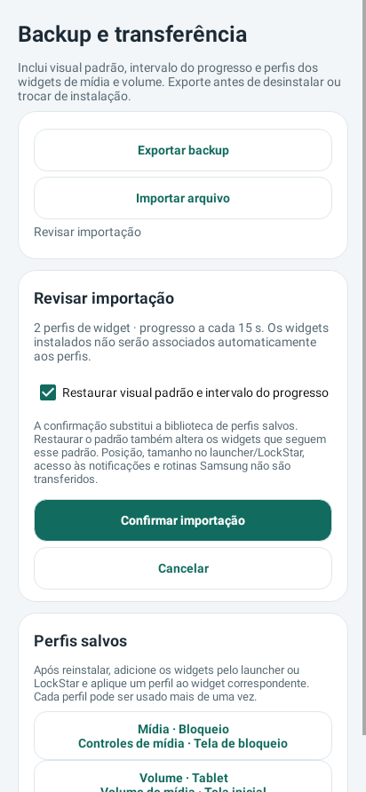
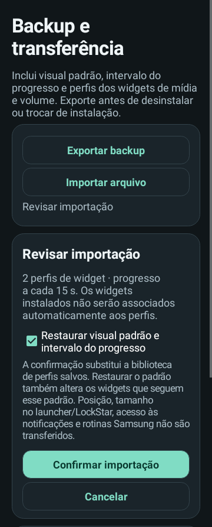

# Media Actions 0.27 experimental

Backup manual com exportação JSON conferida e importação revisada antes de aplicar. Preserva padrão, intervalo e perfis portáveis de widgets de mídia/volume, incluindo herança e localização. Perfis podem ser aplicados a novos widgets após reinstalar; posições e permissões do Android não são transferidas. Atualização do app original, sem novo timer nem permissão de armazenamento.

**[Baixar APK phone 0.27](https://github.com/brenopoubel0324/media-actions-for-samsung-routines/raw/refs/tags/v0.27-experimental/downloads/v0.27-experimental/media-actions-phone-0.27-experimental-debug.apk)** · [Baixar APK Wear 0.9](https://github.com/brenopoubel0324/media-actions-for-samsung-routines/raw/refs/tags/v0.27-experimental/downloads/v0.21-experimental/media-actions-wear-0.9-experimental-debug.apk)

Instale o APK phone 0.27 como atualização do app original, sem desinstalar. Depois abra **Backup e transferência → Exportar ou restaurar configurações**. Exporte e aguarde a conferência antes de remover a instalação que contém seus ajustes.

[Guia completo de backup e migração](https://github.com/brenopoubel0324/media-actions-for-samsung-routines/blob/v0.27-experimental/docs/BACKUP.md). O companion Wear permanece 0.9. Não há novo timer ou permissão de armazenamento.

Validação: **573 testes**, lint aprovado, build e self-audit. [Review](https://github.com/brenopoubel0324/media-actions-for-samsung-routines/blob/v0.27-experimental/docs/reviews/backup-0.27.md) · [Arquivos/checksums](https://github.com/brenopoubel0324/media-actions-for-samsung-routines/tree/v0.27-experimental/downloads/v0.27-experimental).

Instale como atualização sem desinstalar. Mesmo applicationId/certificado, preferências anteriores preservadas e uma permissão normal MODIFY_AUDIO_SETTINGS no phone. Protocolo Wear v1 compatível. As imagens são renderizações nativas Android/Skia, não capturas de Galaxy físico. A transferência pelo seletor/provedor Samsung e a reaplicação no LockStar ainda não foram testadas em hardware. Não houve medição de bateria.

**Somente para quem já usa Media Actions Preview:** [atualização Preview para exportar seus ajustes](https://github.com/brenopoubel0324/media-actions-for-samsung-routines/raw/refs/tags/v0.27-experimental/downloads/v0.27-experimental/media-actions-preview-0.27-migration.apk). Instale sobre a Preview existente, exporte e importe no original; confira seus widgets antes de removê-la. Quem usa o app original não precisa deste APK.

SHA-256 phone: `ad9eb30d67060d7b70ac66a1fa06c805e1551175133a2edd27ebbe5c2dae8824`.
