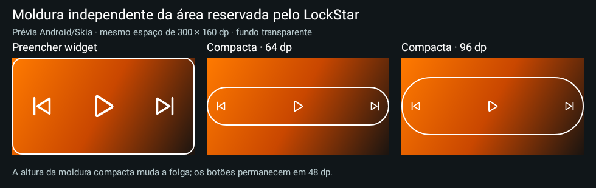
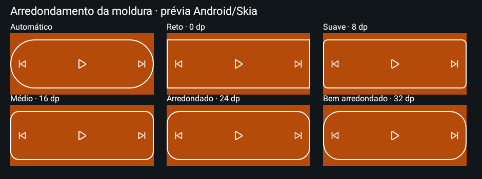
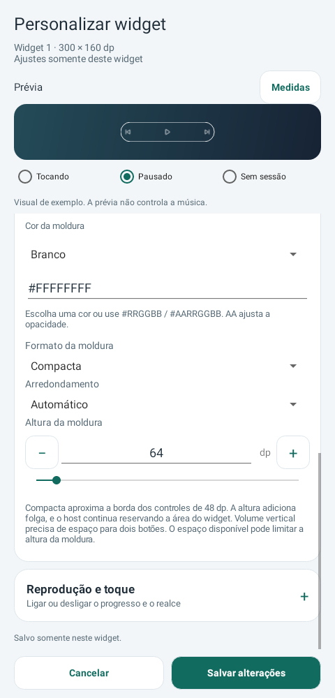

# Media Actions 0.30 estável

Moldura **Compacta** com altura visual de56–160dp (padrão64), independente da altura reservada pelo launcher/LockStar. Ajuste também **Arredondamento**: Automático,0,8,16,24 ou32dp. Automático usa cápsula em Compacta e os cantos anteriores em Preencher widget.

**[Baixar Media Actions 0.30](https://github.com/brenopoubel0324/media-actions-for-samsung-routines/raw/refs/tags/v0.30/downloads/v0.30/media-actions-phone-0.30.apk)**

Instale sobre o original, sem desinstalar. Mesmo package/certificado, code30. Para ativar: **Editar widget instalado → Bordas → Formato da moldura → Compacta**, ajustar altura/cantos e salvar. Widgets existentes mantêm Preencher widget até você escolher mudar.

Controles compactos de48dp quando há espaço; altura adiciona folga sem aumentar botões. Volume mantém orientação H/V e sua área mínima. A moldura é nativa, transparente e sem bitmap ou timer novo. A área reservada e o timeout do host não são alterados por esta opção.

Backups exportam formato2 com modo/altura/cantos; a0.30 importa também formato1. Apps0.27–0.29 recusam arquivos v2. [Guia de backup](https://github.com/brenopoubel0324/media-actions-for-samsung-routines/blob/v0.30/docs/BACKUP.md).

Validação: 1197 execuções de testes Debug/Release, lint, build e review. [Review](https://github.com/brenopoubel0324/media-actions-for-samsung-routines/blob/v0.30/docs/reviews/compact-frame-0.30.md) · [Funcionamento e limites](https://github.com/brenopoubel0324/media-actions-for-samsung-routines/blob/v0.30/docs/COMPACT_WIDGET_FRAME.md) · [Integridade](https://github.com/brenopoubel0324/media-actions-for-samsung-routines/tree/v0.30/downloads/v0.30).

Imagens renderizadas pelo Android/Skia; não são capturas em Galaxy físico. Encaixe no LockStar/aparelho e bateria não foram medidos pelo agente. Wear0.9 permanece compatível; adaptação de cores ao wallpaper segue planejada.

SHA-256: `42ccc7eb0ee83410a9418b3436693a83ab12c30ba78a17d67e054170d2689789`.
