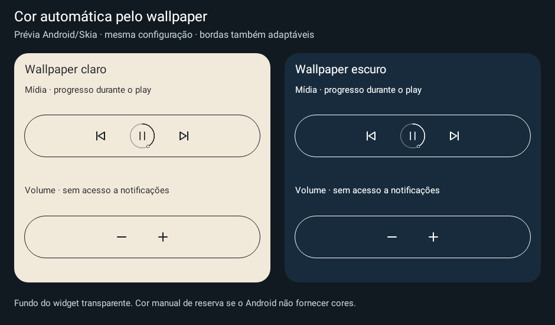
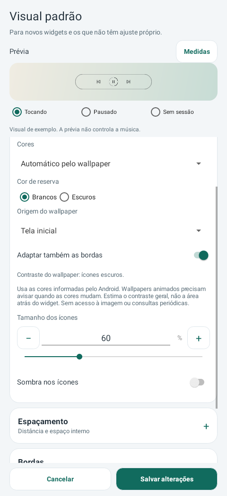

# Media Actions 0.31 estável

Cores automáticas pelo wallpaper nos widgets de mídia e volume: ícones escuros em fundos claros e brancos em fundos escuros, com cor manual de reserva. Origem independente: tela inicial, bloqueio ou localização do widget; bordas adaptáveis opcionais. O indicador acompanha o contraste apenas no modo automático e continua aparecendo somente durante reprodução confirmada.

**[Baixar Media Actions 0.31](https://github.com/brenopoubel0324/media-actions-for-samsung-routines/raw/refs/tags/v0.31/downloads/v0.31/media-actions-phone-0.31.apk)**

Instale sobre o Media Actions original, sem desinstalar. Mesmo pacote/certificado, code31, Release não depurável. Configurações atuais continuam em Manual. Para ativar: **Editar widget instalado → Ícones → Cores → Automático pelo wallpaper**; escolha a origem e salve. No LockStar, selecione Tela de bloqueio quando o local não for informado.

Sem novas permissões, timers, alarmes ou serviços. Usa eventos e cache; consultas iniciais fora da UI, cores repetidas não redesenham e tela apagada suspende as entregas de cor. Mudanças de wallpaper não enumeram sessões; o snapshot de mídia é compartilhado por lote. Ações mantêm suas verificações normais. Sem observador pronto, a apresentação usa estado desconhecido até recuperar.

Depende das cores informadas pelo Android/live wallpaper; não mede a área atrás do widget. Depth/LockStar precisam de validação no aparelho. Os testes demonstram limites de trabalho simulado, não economia de bateria medida. Backups novos usam v3; importa v1/v2/v3. Apps até 0.30 recusam v3.

Prévias Android/Skia, exibidas antes da publicação; não são capturas em Galaxy físico. 1291 execuções Debug/Release, zero falhas/erros/pulos, lint e build aprovados. Review: APROVADO em 2 rodadas, um achado médio de cache e dois baixos corrigidos, nenhum bloqueante/alto restante. Wear 0.9 permanece inalterado.

[Funcionamento e limites](https://github.com/brenopoubel0324/media-actions-for-samsung-routines/blob/v0.31/docs/WALLPAPER_COLORS.md) · [Review](https://github.com/brenopoubel0324/media-actions-for-samsung-routines/blob/v0.31/docs/reviews/wallpaper-colors-0.31.md) · [Integridade](https://github.com/brenopoubel0324/media-actions-for-samsung-routines/tree/v0.31/downloads/v0.31).

SHA-256: `60f6501a7e9eecd925b3410446b49ef3bcabe3fa2047555eff2f750524dc0aa9`.
