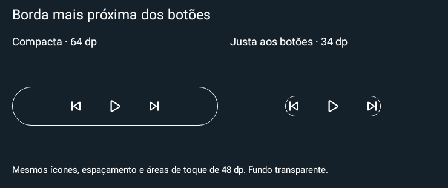

# Media Actions 0.32 estável

Nova opção **Justa aos botões**: a moldura acompanha a área visual dos ícones nos dois eixos, com pouca folga. As áreas de toque continuam com 48 dp quando há espaço e podem ultrapassar a borda decorativa. Sem bitmap de moldura, timer, serviço ou permissão nova.

**[Baixar Media Actions 0.32](https://github.com/brenopoubel0324/media-actions-for-samsung-routines/raw/refs/tags/v0.32/downloads/v0.32/media-actions-phone-0.32.apk)**

Instale sobre o app original, sem desinstalar. Mesmo pacote/certificado, code32, Release não depurável. Ative em **Editar widget instalado → Bordas → Formato da moldura → Justa aos botões** e salve. Os modos antigos e ajustes instalados permanecem iguais até escolher mudar.

No exemplo, ícones 60%, espaçamento 16 dp e borda 1 dp resultam em altura 34 dp, comparada aos 64 dp anteriores. A altura segue a arte dos controles e é automática; tamanho dos ícones e distância continuam editáveis. Bordas individuais e progresso reservam espaço para esses elementos. Volume mantém orientação H/V; cores do wallpaper e cantos continuam disponíveis. A área reservada pelo host permanece sob controle do launcher/LockStar.

Prévias nativas exibidas antes da publicação; não são capturas em aparelho físico. 1321 execuções de testes Debug/Release sem falhas/erros/pulos; lint e build aprovados. Self-audit aprovado em 3 rodadas, um achado médio de reaplicação e dois baixos de UI/fixture corrigidos, nenhum bloqueante/alto restante. Encaixe/toque no LockStar e bateria não foram medidos fisicamente.

Backup exporta v4 e importa v1/v2/v3/v4. Apps até 0.31 recusam v4; exporte uma cópia antes de voltar para versão anterior. Wear 0.9 permanece inalterado.

[Funcionamento e limites](https://github.com/brenopoubel0324/media-actions-for-samsung-routines/blob/v0.32/docs/FITTED_WIDGET_FRAME.md) · [Review](https://github.com/brenopoubel0324/media-actions-for-samsung-routines/blob/v0.32/docs/reviews/fitted-frame-0.32.md) · [Integridade](https://github.com/brenopoubel0324/media-actions-for-samsung-routines/tree/v0.32/downloads/v0.32).

SHA-256: `23bd0435abac49df67675081e872fc53ec45d4966b74eeab9d84464ab380b747`.
