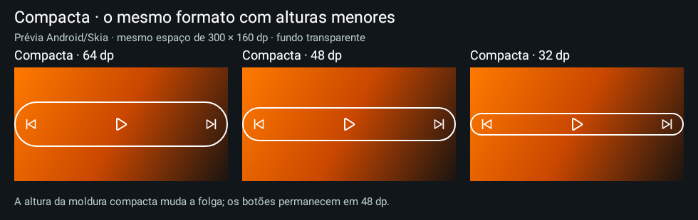

# Media Actions 0.33 estável

**Compacta agora permite altura de 16 a 160dp**, mantendo a largura e as áreas de toque. Basta ajustar o controle de altura já existente. A opção Justa aos botões foi removida do editor.

**[Baixar Media Actions 0.33](https://github.com/brenopoubel0324/media-actions-for-samsung-routines/raw/refs/tags/v0.33/downloads/v0.33/media-actions-phone-0.33.apk)**

Instale sobre o app original, sem desinstalar. Mesmo pacote/certificado, code33, Release não depurável. No editor: **Bordas → Formato da moldura → Compacta → Altura da moldura**. Pode usar 32, 40, 48 dp, por exemplo. O padrão 64 dp e os ajustes instalados não são alterados automaticamente.

Botões conservam alvos de 48 dp quando há espaço. O contorno pode ficar dentro da área clicável. Volume vertical ainda envolve os dois botões. Não acrescenta timer, serviço, permissão, bitmap de moldura ou consulta privilegiada. Cor e cantos permanecem editáveis. A área reservada e o timeout continuam sob controle do host.

Preferências/rascunhos/backups do modo retirado são lidos como Compacta, preservando os demais campos. Backup continua v4 e importa v1/v2/v3/v4. Apps anteriores à 0.33 podem recusar alturas abaixo de 56 dp; use um backup anterior para voltar de versão.

1307 execuções Debug/Release sem falhas/erros/pulos, build e lint aprovados. Self-audit: aprovado em uma rodada, sem achados. Prévias Android/Skia exibidas antes da publicação; encaixe/toque no LockStar e bateria não foram medidos fisicamente. Wear não foi alterado.

[Funcionamento](https://github.com/brenopoubel0324/media-actions-for-samsung-routines/blob/v0.33/docs/COMPACT_WIDGET_FRAME.md) · [Review](https://github.com/brenopoubel0324/media-actions-for-samsung-routines/blob/v0.33/docs/reviews/compact-height-0.33.md) · [Integridade](https://github.com/brenopoubel0324/media-actions-for-samsung-routines/tree/v0.33/downloads/v0.33).

SHA-256: `c6b1cfa954f3437db69be5bdeeb202393bc0d1ead6a804b5d9b388e6b610d77b`.
