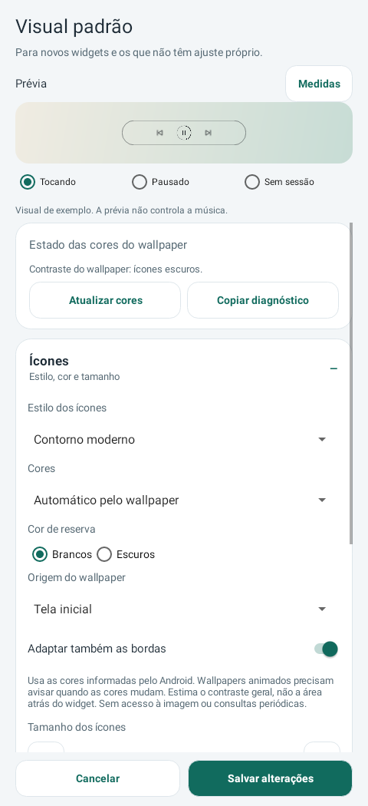

# Media Actions 0.34 estável

O editor mostra **Estado das cores do wallpaper** em um cartão próprio, com **Atualizar cores** e **Copiar diagnóstico**. Distingue ausência de dados, consulta em andamento, falha da API e decisão de contraste. A releitura é manual, fora da UI, apenas para a origem escolhida; copiar usa a paleta em cache.

**[Baixar Media Actions 0.34](https://github.com/brenopoubel0324/media-actions-for-samsung-routines/raw/refs/tags/v0.34/downloads/v0.34/media-actions-phone-0.34.apk)**

Instale sobre o original sem desinstalar. Mesmo pacote/certificado, code 34, Release não depurável. No editor **desse widget**, confirme Automático/Bloqueio, salve se necessário, reabra, toque Atualizar cores, aguarde e copie o diagnóstico. Ele informa também versão/pacote, primária/hints e classe de eventual falha. Sem imagem, notificação, título, stack trace ou mensagem privada da exceção; compartilhamento somente pelo clipboard após toque.

**O caso dos controles brancos sobre fundo branco ainda não tem causa confirmada no aparelho. A detecção a partir do wallpaper não mudou; o uso da reserva nas bordas foi corrigido. Esta versão não confirma correção com Depth.** Os dados coletados permitirão distinguir fonte indisponível/erro, paleta inadequada e entrega/configuração da instância. A reserva permanece disponível; foi corrigido o uso de sua cor também nas bordas quando Adaptar também as bordas está ativo.

Sem permissão, privilégio, serviço ou timer novo. Registro de eventos/cache e limites de tela apagada continuam vigentes; metadados não forçam redraw se o visual do widget não mudar. Editor atualiza status mesmo quando ausência de dados vira falha sem mudar o contraste. Consultas tardias não substituem metadados atuais. Compacta 16–160dp, dois formatos, cores/cantos e backup v4 permanecem.

1343 execuções Debug/Release sem falhas/erros/pulos, build e lint aprovados. Self-audit aprovado em 3 rodadas, dois achados médios e dois baixos corrigidos; nenhum bloqueante/alto restante. Prévias nativas exibidas antes da publicação. Testes simulados não confirmam o diagnóstico físico, compatibilidade com Depth ou economia de bateria. Wear inalterado.

[Diagnóstico e limites](https://github.com/brenopoubel0324/media-actions-for-samsung-routines/blob/v0.34/docs/WALLPAPER_DIAGNOSTIC.md) · [Review](https://github.com/brenopoubel0324/media-actions-for-samsung-routines/blob/v0.34/docs/reviews/wallpaper-diagnostic-0.34.md) · [Integridade](https://github.com/brenopoubel0324/media-actions-for-samsung-routines/tree/v0.34/downloads/v0.34).

SHA-256: `ccfa6b4a291dc3d71b03f9d910edc2ff42ff63c062d38479a52dd02142cae68c`.
